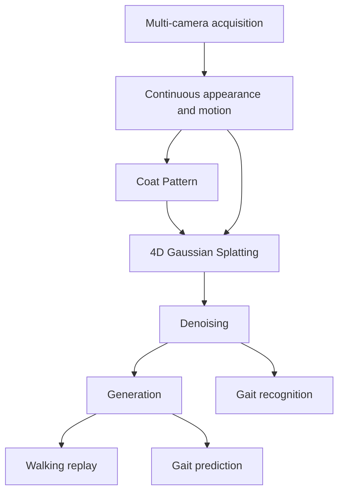

# Cattle4DGS: 4D Gaussian Splatting for Bovine Gait Recognition and Prediction

Bo · Zhengzhou University / Mutong (牧瞳)

Cattle4DGS is a research code framework for individual dairy cattle. Synchronized cameras record a continuous appearance and motion sequence. A coat-pattern embedding keeps identity appearance attached to the animal, dynamic 3D Gaussians represent the walk, a denoising stage stabilizes that representation, and a generator plays the walk back and forecasts the gait. A recognition head reads the same denoised state.

This repository is the scaffold for that study. It defines the data layout, the module order, and the command-line entry points. The photometric loss, the deformation field, the denoiser, and the rasterizer are left open so the experiments can be added in place. No trained weights are released, and no quantitative results are reported here.

## Pipeline

Multi-camera acquisition produces the appearance and motion sequence. The learned path then follows one order: **Coat Pattern → 4D Gaussian Splatting → denoising → generation**. Generation has two outputs, walking replay and future-gait prediction. Gait recognition is a readout of the denoised Gaussians rather than a fifth generative stage.



| Stage | Code | Role in the study |
| --- | --- | --- |
| Acquisition | `cattle4d.data` | Synchronized views, calibration, optional gait labels, optional coat reference |
| Coat Pattern | `cattle4d.models.coat_pattern` | Identity appearance vector from a coat crop or reference image |
| 4D Gaussian Splatting | `cattle4d.models.gaussian4d` | Canonical Gaussians, a time-conditioned deformation, and a render call |
| Denoising | `cattle4d.models.denoiser` | Suppression of unstable Gaussian attributes before synthesis |
| Generation | `cattle4d.models.generator` | Replay of observed time and forecast of future time |
| Recognition | `cattle4d.models.recognizer` | Logits over the label names set in the experiment config |

`Cattle4DPipeline.forward` in `src/cattle4d/pipeline.py` is the single call that keeps this order. Each stage raises `NotImplementedError` after checking its inputs, so a mistaken tensor shape is reported before the missing experiment.

## Repository layout

```text
.
|-- configs/
|   |-- default.yaml
|   |-- path.yaml
|   |-- example_sequence/
|       |-- cameras.yaml
|       |-- gait.json
|-- scripts/
|   |-- train.sh
|   |-- infer.sh
|-- src/cattle4d/
|   |-- config.py
|   |-- pipeline.py
|   |-- data/
|   |-- models/
|   |-- engine/
|   |-- utils/
|-- requirements.txt
|-- pyproject.toml
|-- LICENSE
```

## Environment

The code targets Python 3.10 or newer. Install a PyTorch build that matches the machine from the [PyTorch install page](https://pytorch.org/get-started/locally/), then install the remaining research dependencies. `ultralytics` and `timm` are listed for the detector and the coat backbone that the coat-pattern entry point is expected to host; the stub does not download their weights.

```bash
conda create -n cattle4d python=3.10
conda activate cattle4d
pip install torch torchvision
pip install -r requirements.txt
pip install -e .
```

`pip install -e .` only exposes the package. Numerical dependencies come from `requirements.txt`.

## Dataset

Sequences are stored locally and are not part of this repository. Point `data_root` in `configs/path.yaml` at the tree below. Image files are ordinary RGB frames. The same filename order across cameras is the time index.

```text
${DATA_ROOT}/
|-- sequences/
|   |-- <sequence_id>/
|       |-- cameras.yaml
|       |-- gait.json
|       |-- coat/
|       |   |-- reference.jpg
|       |-- views/
|           |-- cam00/
|           |   |-- 000000.jpg
|           |   |-- 000001.jpg
|           |-- cam01/
|               |-- 000000.jpg
|               |-- 000001.jpg
|-- splits/
    |-- train.txt
    |-- val.txt
    |-- test.txt
```

| File | Required | Contents |
| --- | --- | --- |
| `cameras.yaml` | yes | `fps` and, per camera, `width`, `height`, intrinsics `K` (3×3), and camera-to-world `c2w` (4×4) |
| `views/<camera>/*` | yes | Frames for that camera. Sorted filenames must match across cameras |
| `gait.json` | no | `cow_id` and a list of `{frame, timestamp, name}` labels |
| `coat/reference.jpg` | no | Coat crop or pattern image consumed by the coat encoder |
| `splits/<split>.txt` | for a named split | One sequence id per line. Lines starting with `#` are comments |

`configs/example_sequence/` shows the YAML and JSON fields. The numbers in that sample are schema placeholders. Replace them with the calibration and the labels of the capture before training.

A public corpus with the same capture pattern is [MmCows](https://github.com/neis-lab/mmcows) (Vu et al., NeurIPS 2024 Datasets and Benchmarks): four isometric cameras over a dairy pen, with identity and behavior annotations that include walking. Cattle4DGS does not redistribute MmCows. Download it from the authors, set `mmcows_root`, and use the adapter entry point when the walking-cycle export is implemented:

```bash
python -m cattle4d.data.mmcows \
  --mmcows-root /path/to/mmcows \
  --output-root /path/to/cattle4d_sequences
```

That command currently stops inside `convert_walking_sequences`. Frame selection, animal cropping, and the split files are part of the experiment.

Users who record their own animals remain responsible for institutional animal-care approval. Nothing in this repository is an animal record.

## Configuration

`configs/path.yaml` holds machine-local directories. `configs/default.yaml` holds the model widths and the optimization block. Fields left `null`, including the learning rate, the epoch count, the temporal window, and the recognition label list, are choices for a concrete run. They are not a selected hyperparameter set.

Edit the two files, then pass them explicitly. The shell scripts pass the copies in `configs/`.

## Training

Dry run, which builds the module graph and does not read images or write a checkpoint:

```bash
bash scripts/train.sh --dry-run
```

Equivalent module call:

```bash
python -m cattle4d.engine.train \
  --config configs/default.yaml \
  --paths configs/path.yaml \
  --dry-run
```

A real run, after `data_root` points at a sequence tree and `optim.lr`, `optim.epochs`, and the label list have been set:

```bash
bash scripts/train.sh --split train
```

`cattle4d.engine.train.fit` is the optimization entry point. It checks that a learning rate and an epoch count exist, then stops. The loss that ties replay, prediction, and recognition together is added in that function. Until then the command exits with `NotImplementedError` and writes nothing under `output_dir`.

## Inference

Dry run:

```bash
bash scripts/infer.sh --dry-run
```

Replay and prediction for one sequence, using a checkpoint produced by a completed `fit`:

```bash
bash scripts/infer.sh \
  --checkpoint /path/to/checkpoint.pt \
  --sequence <sequence_id>
```

Module form:

```bash
python -m cattle4d.engine.infer \
  --config configs/default.yaml \
  --paths configs/path.yaml \
  --checkpoint /path/to/checkpoint.pt \
  --sequence <sequence_id> \
  --output-dir outputs
```

`cattle4d.engine.infer.run` is the synthesis entry point. Once it is implemented, the intended products are:

```text
outputs/<sequence_id>/replay/<camera>/<frame>.png
outputs/<sequence_id>/prediction/<camera>/<frame>.png
outputs/<sequence_id>/recognition.json
```

The current function checks the sequence directory and the checkpoint path, then stops. It does not read the checkpoint and it does not write images. There is no released weight file to point `--checkpoint` at.

## Citation

If you use this scaffold, please cite the repository and the two lines of work it is built to connect: dynamic Gaussian splatting, and the MmCows multi-camera cattle corpus.

```bibtex
@misc{bo2026cattle4dgs,
  title        = {Cattle4DGS: 4D Gaussian Splatting for Bovine Gait Recognition and Prediction},
  author       = {Bo},
  year         = {2026},
  howpublished = {Zhengzhou University / Mutong (牧瞳)},
  note         = {Research code repository. Manuscript in preparation.},
  url          = {https://github.com/tianyi-star/4d_cattle}
}

@inproceedings{wu20244dgs,
  title     = {4D Gaussian Splatting for Real-Time Dynamic Scene Rendering},
  author    = {Wu, Guanjun and Yi, Taoran and Fang, Jiemin and Xie, Lingxi and Zhang, Xiaopeng and Wei, Wei and Liu, Wenyu and Tian, Qi and Wang, Xinggang},
  booktitle = {Proceedings of the IEEE/CVF Conference on Computer Vision and Pattern Recognition (CVPR)},
  year      = {2024}
}

@article{kerbl20233dgs,
  title   = {3D Gaussian Splatting for Real-Time Radiance Field Rendering},
  author  = {Kerbl, Bernhard and Kopanas, Georgios and Leimk{\"u}hler, Thomas and Drettakis, George},
  journal = {ACM Transactions on Graphics},
  volume  = {42},
  number  = {4},
  year    = {2023}
}

@inproceedings{vu2024mmcows,
  title     = {{MMCows}: A Multimodal Dataset for Dairy Cattle Monitoring},
  author    = {Vu, Hien and Prabhune, Omkar and Raskar, Unmesh and Panditharatne, Dimuth and Chung, Hanwook and Choi, Christopher Y. and Kim, Younghyun},
  booktitle = {Advances in Neural Information Processing Systems},
  year      = {2024},
  note      = {Datasets and Benchmarks Track}
}
```

## License

Copyright 2026 Bo, Zhengzhou University / Mutong（牧瞳）.

Released under the Apache License, Version 2.0. The full text is in [LICENSE](LICENSE).

## Contact

Bo, Zhengzhou University / Mutong (牧瞳).
